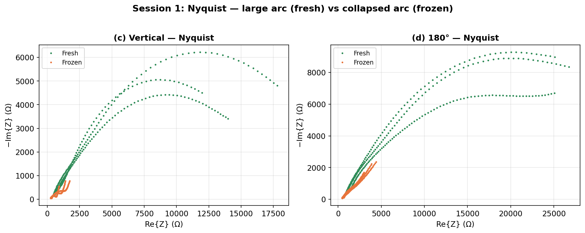
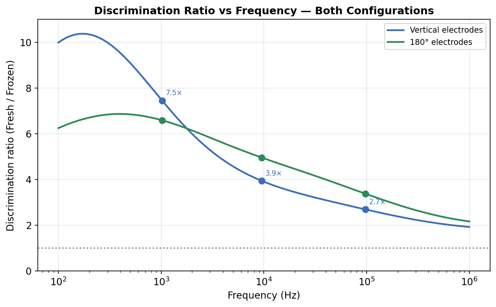
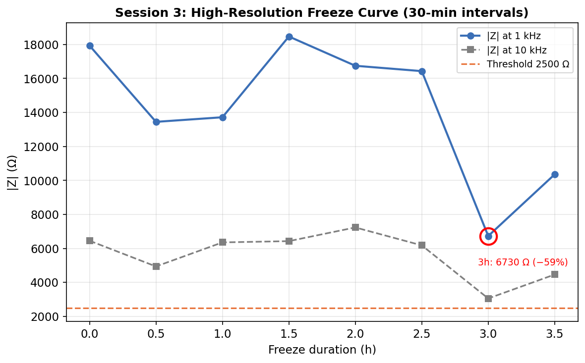
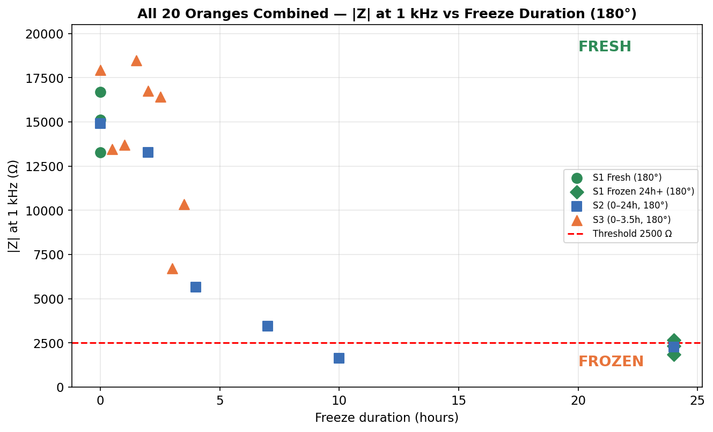
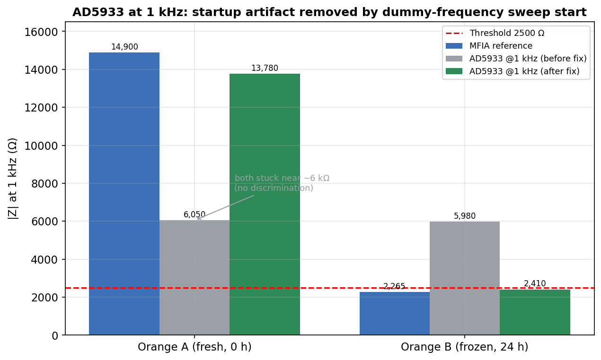
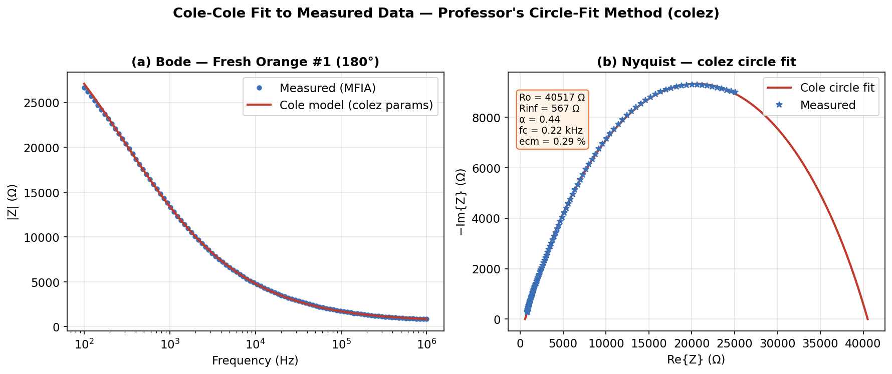

# ORANGE-FRESH: Detecting Previously Frozen Oranges with Impedance Spectroscopy

Frozen-then-thawed oranges look exactly like fresh ones, but ice crystals rupture the cell membranes, and that changes the fruit's **electrical impedance**. This project measured that effect with **electrical impedance spectroscopy (EIS)**, built a simple and reliable classifier from it, and moved the measurement onto a **~€30 portable prototype** (AD5933 + Arduino Nano).

**[Interactive project presentation with a Cole–Cole/Nyquist simulator](https://antabianshahan.github.io/orange-fresh-eis/)** (proposal stage) · **[Full report (PDF, 54 pages)](docs/frozen_orange_detection_EIS_paper.pdf)**

## Results

- **7.45× fresh/frozen impedance ratio at 1 kHz**, measured with a Zurich Instruments MFIA over 3 lab sessions and 20 oranges.
- **100% classification** of the 20 oranges with one threshold, **|Z| = 2,500 Ω at 1 kHz**. The threshold sits in the middle of the gap between the two groups.
- **Freeze progression mapped at 30-minute resolution**: the core freezes between **2.5 and 3 h at −18 °C**.
- **Portable prototype validated against the MFIA.** An AD5933 start-up artefact made the first sweep point (1 kHz) read about 6 kΩ for every orange. The artefact comes from the DDS not settling. Starting the sweep at a 500 Hz dummy point and discarding it brings the 1 kHz reading back to within **~7% of the MFIA**. That was checked on 2 oranges.

| Fresh vs frozen (Nyquist) | Discrimination ratio vs frequency |
|---|---|
|  |  |
| **Freeze curve, 30-min steps (session 3)** | **All 20 oranges vs the 2,500 Ω threshold** |
|  |  |
| **AD5933 at 1 kHz, before and after the fix** | **Cole–Cole circle fit to MFIA data** |
|  |  |

## How it works

1. **Physics.** Intact cell membranes behave like capacitors, so fresh tissue has a large low-frequency impedance and a wide Cole–Cole arc. Freezing ruptures the membranes and the current leaks through, so the arc collapses and |Z| at 1 kHz drops by about 7×.
2. **Reference measurements.** Two-electrode MFIA sweeps from 100 Hz to 1 MHz were taken in two electrode configurations (vertical and 180°) over three sessions: fresh vs frozen, freeze duration from 0 to 24 h, and freeze duration from 0 to 3.5 h in 30-minute steps.
3. **Modelling.** Cole–Cole parameters (R₀, R∞, α, f<sub>c</sub>) were fitted to the visually selected arc points only, leaving out electrode polarisation and high-frequency artefacts.
4. **Decision.** The fruit is classified FRESH or FROZEN by comparing |Z| at 1 kHz with the 2,500 Ω threshold.
5. **Portable version.** The AD5933 (DDS excitation + DFT) is read by an Arduino Nano over I²C. It is calibrated with a 4.7 kΩ reference resistor and holds the orange in a 3D-printed support.

## Repository layout

```
index.html        interactive web presentation (GitHub Pages)
analysis/         MATLAB: all MFIA data (impedance_data.m), plots, statistics, Cole-Cole fitting
firmware/         Arduino sketch for the AD5933 sweep (I2C, gain calibration, CSV over serial)
hardware/         3D-printed holders used during measurement (STL; GitHub previews them in 3D)
figures/          figures used in the report
docs/             final report (PDF)
```

To reproduce the plots, run `plot_all_impedances.m` or `orange_analysis_all_labs.m` in MATLAB. Both load `impedance_data.m`. `run_colez_fitting.m` also needs `colez.m`, the Cole circle-fit routine provided by the course. It is not redistributed here. The firmware uses the open-source Arduino AD5933 library.

## Team and my role

Group project for Electronic Measurement Systems in the MSc Electronic Engineering at UPC Barcelona (spring 2026), by **Shahan Antabian, Borja Aguilar Garcia, Sergi López Pajuelo and Pol Santana Fajardo**.

My part was the measurement-data analysis and figures, the Cole–Cole model fitting, a review of the AD5933 firmware, writing the report, and the interactive web presentation in `index.html`.
